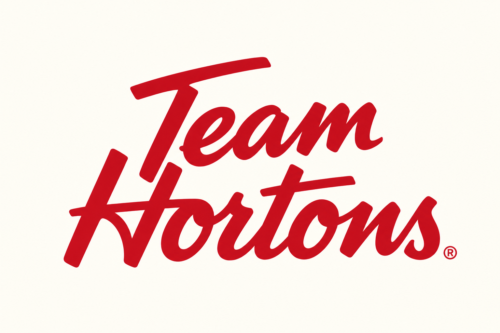
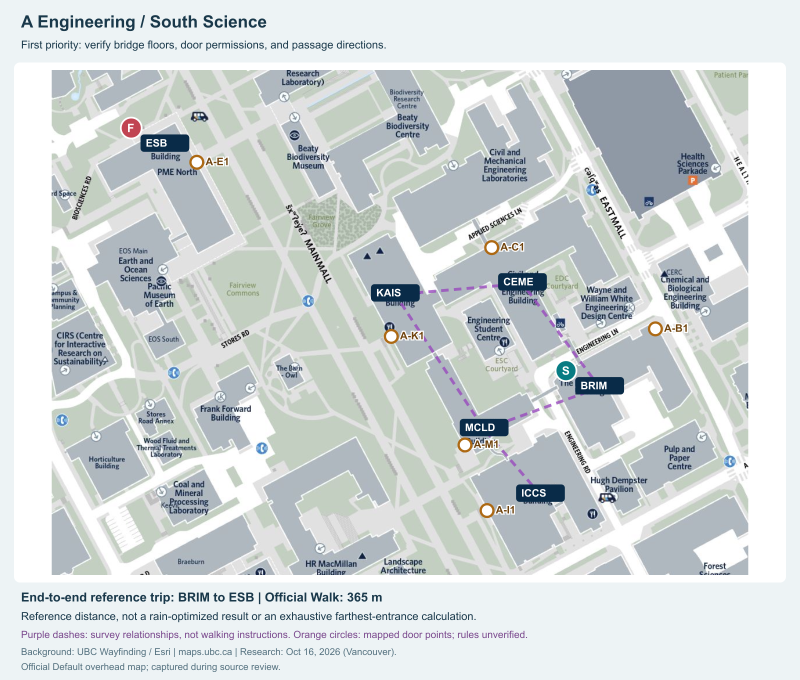
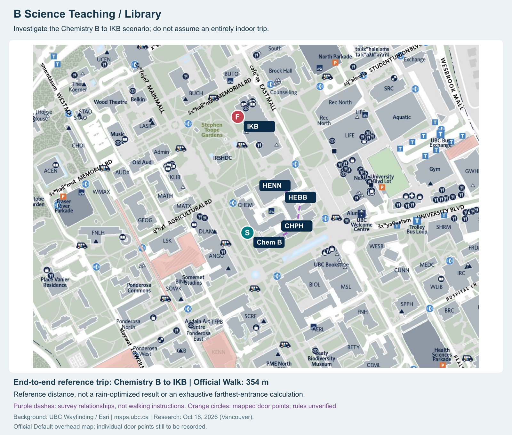
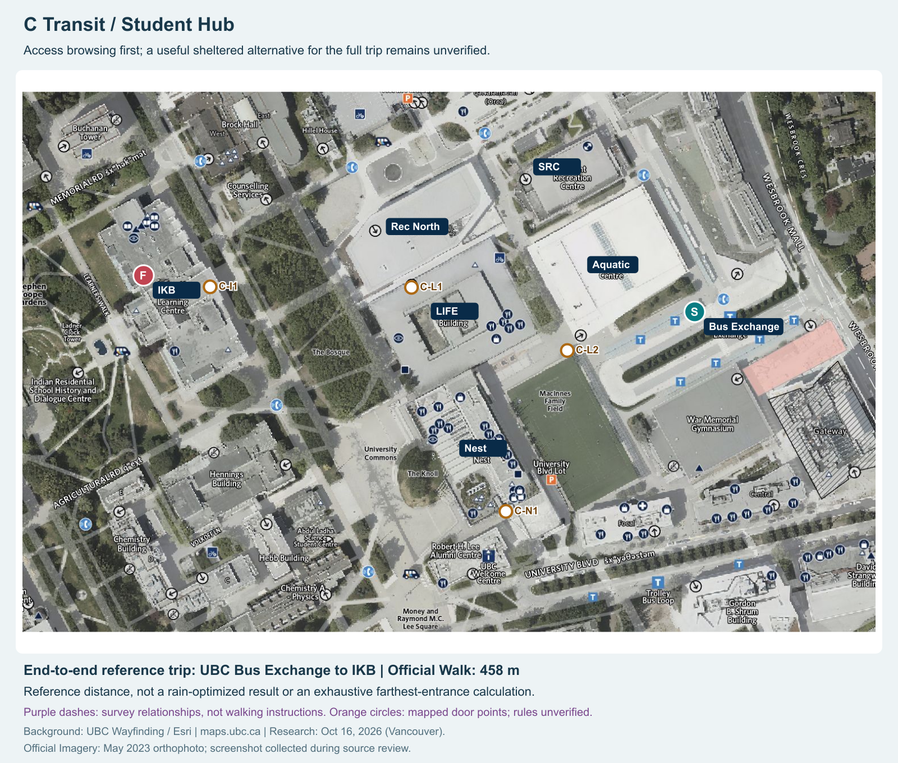

  

# Hortons Rain Routes

## UBC building access information and rain-aware route planning

**Course:** CPEN 221A Team Project  
**Milestone 1:** Design Your Team and Design Your Solution  
**Team:** Hortons  
**Members:** Tim, Yuki, Stark, Leon, Ryan  
**Project Manager:** Tim · **Design Lead:** Yuki · **Development Lead:** Stark  
**Version:** 3.1 — English submission package  
**Source review and map queries:** October 16, 2026, Vancouver / October 17, 2026, UTC.

> **Current status:** Public-source research, official map queries, three regional map backgrounds, and interface sketches have been assembled. Student interviews, on-site route verification, entrance photography, and door-level access checks are planned next. Survey lines in the illustrations are not verified walking routes. The SVG storyboard (`core-flow.svg`) illustrates the proposed interaction; it is a static design artifact, not an implemented route planner.

## 1. Mission and problem

**Our mission is to help UBC students understand which building entrances they can use, whether they can walk through a building, and when those paths are available, and to find routes with less exposed walking when useful alternatives exist.**

Students can locate a building on an existing map yet still be uncertain about a side entrance's closing time, access permissions, the floor containing a connecting bridge, or the exit on the other side. In rainy weather, these information gaps can cause door searching, failed entry attempts, and backtracking.

The product supports two equally important uses:

1. **Route planning:** Select an origin, destination, departure date and time, and acceptable extra walking time. Compare available routes and see which doors to enter and leave and how to walk through each building.
2. **Access map browsing:** Open a regional map without entering a complete trip. Select buildings and entrances to inspect hours, permissions, exits, and internal connections. A student who only wants to cross one building can still use the product.

The initial information will be collected, checked, and maintained by the team. The product does not depend on a large volume of user submissions before it becomes useful. User reports can provide leads for later verification.

### Confirmed scope: route display without GPS

The application provides **route planning and display based on user-entered locations**. Users choose their origin, destination, and departure time. The application displays eligible paths, entrance photographs, and passage instructions. Users consult these materials while walking.

The MVP does not use GPS, track the user's movement, automatically advance instructions, provide live turn prompts, or automatically reroute after a deviation. Location permission is not required. A selected departure time is used to check recorded access rules; it does not reveal a lock's live state.

## 2. Evidence of need and existing alternatives

### 2.1 Specific situations

- In an [r/UBC discussion dated October 31, 2025](https://www.reddit.com/r/UBC/comments/1ol3eje/), the author describes difficulty travelling from **Chemistry B to IKB** in the rain. Some replies discuss engineering-building connections and covered paths; many others recommend umbrellas or rain jackets. This supports a specific individual use case, but does not establish that most students need another application.
- A [March 7, 2023 discussion about the longest indoor path at UBC](https://www.reddit.com/r/UBC/comments/11kquit/) identifies possible engineering-building connections and a HENN–HEBB–Chem/Phys–Chem chain. Some participants ask how the buildings connect. The discussion suggests a gap between a connection existing and students knowing how to use it. Historical comments do not establish current access rules.
- A team member has also reported uncertainty about exits and card access. This is a starting point for interviews and observation, rather than evidence of campus-wide demand.

A supporting screenshot of the rain discussion is included as `assets/reddit-rain-user-screenshot.png`. The original links, dates, contrary opinions, and limitations are summarized above. The screenshot is supporting evidence, not an interview record. Public-source research and official map queries were collected with AI assistance for team review; they do not represent completed fieldwork.

### 2.2 What the official map already provides

[UBC Wayfinding](https://maps.ubc.ca/) already provides buildings, entrance symbols, walking and accessible routes, and written directions. Its [official description](https://maps.ubc.ca/About.html) states that only main and some secondary entrances are shown and that people familiar with a building may find quicker ways not shown on the map.

The recorded BRIM → ESB query includes a 34-metre segment named **Kaiser**. We therefore cannot assume that all official routes remain outdoors or that UBC offers no through-building routing. The segment name alone does not establish its rain protection or door-level access conditions.

**Proposed additional value:** Make door-level conditions, floor changes, and passage instructions understandable, and present an explicit trade-off between extra walking time and reduced exposed distance on a verified network. Actual route measurements and user tasks must establish whether this adds useful value.

## 3. Three pilot regions and checked reference trips

The official map was operated directly: specific search results were selected, Walk-mode endpoints and total distances were checked, and screenshots and written directions were saved. These are **official route distances**, not straight-line estimates, field measurements, or outputs from our proposed rain-aware algorithm.

| Pilot | Core area and representative end-to-end trip | Official Walk distance | Rationale and current conclusion |
|---|---|---:|---|
| A — Engineering / South Science | ESB, KAIS, CEME, MCLD, ICCS, BRIM; **BRIM → ESB** | **365 m** | Multiple teaching buildings and documented bridge connections provide specific leads. A second query, ICCS → ESB, is 308 m. This is the first priority for passage verification. |
| B — Science Teaching / Library | Chemistry B/C/D/E, CHPH, HEBB, HENN, IKB; **Chemistry B → IKB** | **354 m** | Matches the explicit Reddit scenario and includes a teaching-to-study trip as well as single-building passage tasks. Each connection requires verification. |
| C — Transit / Student Hub | UBC Bus Exchange, Aquatic Centre, SRC / Rec North, LIFE, Nest, IKB; **Bus Exchange → IKB** | **458 m** | Combines transit, student services, food, and study destinations. LIFE and Nest publish building hours. A useful indoor alternative for the complete trip has not yet been established. |

**What these spans mean:** These are relatively long representative trips across the proposed corridors, rather than very short trips between adjacent buildings such as Nest and LIFE. No all-pairs calculation has been performed for every entrance, so they are not claimed to be the mathematically farthest pairs. Once the supported entrances are fixed, the maximum supported span can be calculated on the actual network.

**Student activity and regional selection:** Teaching, transit, service, and study uses are selection indicators. Official sources provide further qualitative support: [UBC Walking](https://planning.ubc.ca/transportation/walking) identifies Main Mall, Agricultural Road, and University Boulevard among the pedestrian-priority corridors; the [Public Realm Plan](https://planning.ubc.ca/planning-development/policies-and-plans/public-realm-planning/public-realm-plan) identifies key pedestrian corridors and gathering spaces; a [2018 explanation of campus cycling policy](https://planning.ubc.ca/news/where-are-bike-lanes) discusses congestion and crossing flows on Main Mall and University Boulevard. A/B relate to the teaching corridor around Main Mall, while C connects transit and the student hub. These sources do not constitute a 2026 footfall comparison or a ranking of the three busiest areas. Comparable observation windows may be used later to refine priorities.

### A — Engineering / South Science

Buildings, paths, and original entrance symbols come from the official map. Added identifiers support data collection. Purple dashed lines identify connections to investigate, not confirmed corridor geometry. The original 365 m route screenshot is `assets/engineering-brim-esb-route-source.jpg`.

### B — Science Teaching / Library

Chemistry B → IKB represents a complete teaching-to-study trip. The CHEM–CHPH–HEBB–HENN relationships come from historical discussion and require on-site checks. The section leading to IKB must not be assumed to be entirely indoors. The original route screenshot is `assets/science-chem-b-ikb-route-source.jpg`.

### C — Transit / Student Hub

This map uses the official **Imagery** background. The [official map description](https://maps.ubc.ca/About.html) dates the orthophoto to **May 2023**. The screenshot was collected during this research, but the imagery is not live; construction and building changes still require verification. The original route screenshot is `assets/hub-bus-ikb-route-source.jpg`.

## 4. How the sources inform the design

| Source | Information found | Use and limitation |
|---|---|---|
| [Official map description](https://maps.ubc.ca/About.html) | Basemaps, building labels, some entrances, Walk routes, imagery date | Geographic background and reference routes; not a source for every door's schedule. |
| [ICICS/CS floor plans](https://www.cs.ubc.ca/labs/imager/images_2021/allfloors.pdf) | Main entrance, corridors, stairs, elevators, and a MacLeod direction label | Helps target field visits. A file under a 2021 path does not guarantee current access conditions. |
| [MacLeod Renewal PDF](https://vpfo-facilities.sites.olt.ubc.ca/files/2020/02/UBC-MacLeod-Renewal.pdf), page 1 | Historical connections to Kaiser and Level 3 bridges to ICICS and Brimacombe | Specific floors and connections to investigate; 2020 design material is not a current access policy. |
| [ECE Facilities](https://eng-services.ece.ubc.ca/facilities/) | Renewal and bridge upgrades associated with the 2022 renovation | Cross-checks historical drawings; doors and passages still need verification. |
| [IKB Wayfinding](https://ikblc.ubc.ca/spaces/wayfinding/) | Indoor wayfinding resources and a link to the library hours portal | Link indoor resources from building cards; distinguish service hours from building hours. |
| [LIFE](https://students.ubc.ca/about-student-services/ubc-life-building/) / [Nest](https://www.ams.ubc.ca/your-building/) | LIFE: weekdays 07:00–22:00, weekends 08:00–20:00, closed on UBC statutory holidays. Nest regular hours: weekdays 07:00–23:00, weekends 08:00–23:00. | Display published building hours, not assumed schedules for every side door. Handle holiday exceptions separately. |
| [UBC Library Hours](https://hours.library.ubc.ca/) | IKB regular fall 2026 hours 06:00–24:00; October 30–31 exception 06:00–20:00 | Demonstrates date-specific exceptions; do not hard-code regular hours indefinitely. |
| [MCLD 3008](https://learningspaces.ubc.ca/classrooms/mcld-3008/) | This classroom requires keycard access after 17:00 on weekdays and all day on weekends | The rule applies to the classroom, not automatically to all building entrances. |

## 5. Proposed interface

The [interface storyboard](core-flow.svg) uses the actual regional maps and illustrates route entry, building and entrance selection, and access-map browsing. It is a design artifact, not completed routing software.

### Page 1 — Choose a task or enter a trip

- Provide origin, destination, departure date/time, and maximum extra walking time.
- Offer **Browse access map** without requiring a route query.
- Select locations from a supported list rather than accepting arbitrary places and producing unsupported results.
- Default to an ordinary visitor with no additional access permissions; use only explicitly recorded permission categories.

### Page 2 — Regional map, buildings, and entrances

- Switch among the three areas; keep building labels and entrance identifiers aligned during zooming.
- Select a building for an overview, or an entrance for **door hours, access requirements, reachable exits/floors, photographs, sources, and verification dates**.
- Show incomplete information as **Unknown / Verification pending**. Published building hours must not become a claim that a particular door is confirmed open.
- Describe time-based status as **Expected available under recorded rules**. The system has no lock sensors.
- Offer **Cross this building**: choose an entrance and an exit and inspect a verified internal passage without planning a complete cross-campus trip.

### Page 3 — Compare and inspect routes

- Display total distance, estimated time, exposed distance, and additional walking time for the baseline and lower-exposure option.
- Use distinct line styles for indoor, covered outdoor, and exposed segments, with entrances, exits, and floor changes identified.
- If no verified alternative exists, state that clearly and retain access-map browsing.
- If both options are identical, display one route rather than inventing a benefit.
- Users manually inspect the line, step cards, and photographs. The map does not follow their position.

## 6. Implementation approach

**Build reliable information on real maps first, then connect it to route computation.**

1. Save a fixed official overhead map extent for each region, including its source, capture date, dimensions, and version.
2. Store building areas, entrance coordinates, and attributes separately from the image. The image provides context; structured data supports selection and queries.
3. Model doors, internal junctions, stairs/elevators, bridge endpoints, and outdoor intersections as graph nodes, with actual walkable connections as directed edges.
4. Record distance, estimated time, exposed length, floor, permissions, schedules, sources, and verification status on edges. Entry and exit directions may have different rules.
5. Exclude closed, unauthorized, or unverified restricted indoor segments. Find a baseline feasible route and then a lower-exposure option within the user's detour limit.
6. Display results as map polylines and passage instructions. Browsing and route planning share the same entrance records.

The proposed initial stack is **HTML/CSS/JavaScript with SVG overlays**. Fixed regional images can support the MVP without campus-wide GIS or live positioning. Routing and schedule checks can initially run in the browser; a server can be added later if shared maintenance or query requirements justify it. [Design Specification](DESIGN_SPEC.md) details the data, computation, and error handling.

## 7. Next fieldwork

### A. Interview students first

Begin with approximately five students who recently used the candidate areas. Ask about actual rainy-day trips, wrong entrances or backtracking, knowledge of indoor paths, current workarounds, acceptable detours, and the value of looking up a building's entrances. This is an adjustable research target, not a claim of completed interviews or a course-mandated sample size.

Record anonymized trips, difficulties, and selected quotations before deciding which routes to prioritize. Avoid relying on a leading question such as “Would you use our app?” Footfall counts can supplement the selection evidence, but are not a prerequisite for interviews or route visits.

### B. Walk the complete routes

Start with the engineering area. Walk each selected trip from its actual origin to destination, recording doors, floors, turns, bridges, exits, exposed gaps, distance, and time. Check both directions if the route is intended to support both; apparent connections on a map are insufficient.

Aim to verify at least one end-to-end trip per area and compare a normal route with any feasible sheltered alternative. Only then report exposed-distance reductions, detour times, and complete passage instructions. If an area offers no useful alternative, retain the access information and report that outcome.

### C. Photograph entrances and difficult decision points

For each supported entrance, take a contextual approach photograph, a clear door/door-label photograph, and any posted schedule or access sign. Add landmarks for floor changes, turns, and bridges. Identify each photograph by region, building, door ID, and date so the application can reference it consistently.

### D. Check each door's hours and permissions

Record weekday/weekend schedules, date exceptions, card or permission requirements, permitted directions, and sources. Keep published or staff-confirmed rules separate from an observation at one particular time. Building hours cannot automatically be applied to side doors; one unlocked observation does not establish permanent public access. Preserve unknown fields as unknown.

Route walking, photography, and access checks can take place during the same visit, followed by a second member's independent review. The four tasks above define the immediate fieldwork; recording fields and review procedures are specified in Sections 6 and 8 of the [Design Specification](DESIGN_SPEC.md).

**Relationship to the MVP:** The goal is a browsable map and key entrance information in all three regions. Route recommendations cover only passages that have been fully verified. Three map images do not imply three completed routing networks.

## 8. Team and working arrangements

| Member / role | Main responsibilities and deliverables |
|---|---|
| Tim — Project Manager | Maintain scope, task board, source register, research schedule, meeting notes, and milestone checks; coordinate field visits and review, and keep unresolved information visible. |
| Yuki — Design Lead | Define map layers, markers, entrance cards, the three page types, and single-building passage workflows; coordinate usability reviews. |
| Stark — Development Lead | Define data structures, map interaction/layers, schedule handling, graph search, route display, and deployment. |
| Leon — Team member | Contribute supporting design, development, data collection, or review tasks as agreed and recorded on the task board. |
| Ryan — Team member | Contribute supporting development, data collection, or review tasks as agreed and recorded on the task board. |

Specific supporting assignments for Leon and Ryan remain to be agreed; this proposal does not invent completed contributions. Fieldwork is shared rather than assigned exclusively to one lead role.

The provisional meeting time is **Thursday at approximately 19:00 for about two hours**, with asynchronous updates between meetings. Tasks have an owner and deadline. Disagreements are discussed using evidence of need, feasibility, and available time. Members work autonomously and raise obstacles early so work can be redistributed. The task board should capture the team's confirmed supporting assignments.

## 9. Completion and evaluation criteria

- Three real maps identify the relevant buildings and distinguish map sources, imagery dates, and survey annotations.
- Students can inspect entrances and single-building passage information without submitting a complete route.
- Supported routes are continuous, with consistent door, floor, and instruction records and traceable sources.
- Hours, permissions, unknown states, closures, and date exceptions are distinguished correctly.
- Benefits come from measurements, not estimates presented as findings. The absence of a useful alternative is reported honestly.
- As a proposed evaluation target, invite at least five students unfamiliar with the selected passages to find doors, cross a building, and complete a trip using the displayed materials. Record wrong turns, completion time, and interpretation difficulties, then report changes and limitations.

## Submission files

| File | Purpose |
|---|---|
| [README.md](README.md) | Project overview, evidence, scope, team, and next steps |
| [DESIGN_SPEC.md](DESIGN_SPEC.md) | Detailed behaviour, data model, and implementation proposal |
| [core-flow.svg](core-flow.svg) | Standalone English interface storyboard with embedded real maps |
| `assets/` | Team logo, three English regional map illustrations, and original supporting screenshots |

Keep `assets/` beside the Markdown files so that the regional illustrations and supporting screenshots remain available.

Map and source materials remain attributable to their respective rights holders. This package credits UBC Wayfinding / Esri and identifies original sources. Deployment should follow the terms of the selected layers and assets, including attribution and update requirements. Hortons Rain Routes is not an official UBC service.
