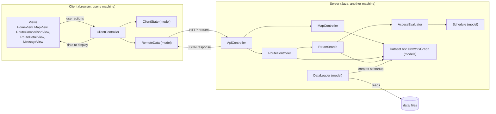
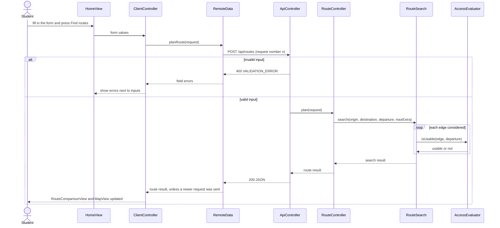

# Hortons Rain Routes — Architecture

**CPEN 221A · Architecture · Draft v0.4 (for team review)**
**Read with:** [README.md](README.md) (problem and scope), [DESIGN_SPEC.md](DESIGN_SPEC.md) (design specification), `requirements.md`

This document follows the course's Architecture phase. It uses the client-server and Model-View-Controller concepts and describes every model, view and controller in the application: its **responsibility**, **where it resides** (client, server or both), and **which components it communicates with and precisely what they communicate**. The stubs for these components are listed in §7.

**Scope.** This document defines what the team will build. Where DESIGN_SPEC.md differs, this document takes precedence and DESIGN_SPEC.md should be updated to match.

---

## 1. Overview

### 1.1 What the application does

A student picks an origin and a destination from a list of places on one campus region, a departure time, and the most extra walking time they will accept to stay dry. The application returns up to two walking routes: the **fastest** route, and a **lower-exposure** route that keeps the student out of the rain as much as possible without exceeding the extra time. Routes are shown on a map, with outdoor, covered and indoor segments styled differently.

### 1.2 Client and server

The application has two kinds of components that exchange messages over HTTP:

- **Client:** a web page (HTML, CSS, JavaScript) running in the user's browser on the user's own machine. It shows the map and routes, and collects the user's input.
- **Server:** a Java program running on a different machine. It holds the team's published data, decides which doors are open, and computes routes.

The client sends HTTP requests and the server replies with JSON. Every message they exchange is listed in §3. During development both can run on one computer; the release runs them on different machines.

### 1.3 Where the models, views and controllers live

| | Client | Server |
|---|---|---|
| **Models** | ClientState, RemoteData (client-side model of the server's data) | Dataset, NetworkGraph, Schedule, DataLoader |
| **Views** | HomeView, MapView, RouteComparisonView, RouteDetailView, MessageView | None. The server returns JSON only. |
| **Controllers** | ClientController | ApiController, MapController, RouteController, RouteSearch, AccessEvaluator |

All access rules and route logic are on the server, so they are implemented and tested once. The client never decides whether a door is usable.

### 1.4 Component diagram

Arrows mean "sends requests to".



---

## 2. Components

### 2.1 Views

**HomeView**
- **Responsibility:** shows the route form: origin, destination, departure date and time, and maximum extra walking time.
- **Resides on:** client.
- **Communicates with:** only **ClientController**.
  - Sends the form values when the user presses **Find routes**.
  - Receives the selectable places to offer in the form, and per-field error messages to show next to the inputs.

**MapView**
- **Responsibility:** draws the fixed background image of the region with an SVG overlay of building outlines, selectable places and route lines, plus a legend. One coordinate transform converts normalized coordinates (`x_norm`, `y_norm`) to screen positions for every layer, so overlays stay aligned when the user zooms or pans.
- **Resides on:** client.
- **Communicates with:** only **ClientController**.
  - Sends place clicks (place id), which set the origin or destination.
  - Receives the map to draw (image URL, building outlines, selectable places) and the route segments to highlight.

**RouteComparisonView**
- **Responsibility:** shows up to two options, fastest and lower exposure, with total distance, walking time, exposed distance, extra time and exposure reduction. Shows a single option when both are identical, and explains why when no route exists.
- **Resides on:** client.
- **Communicates with:** only **ClientController**.
  - Receives a route result.
  - Sends the option the user selects (`FASTEST` or `LOWER_EXPOSURE`).

**RouteDetailView**
- **Responsibility:** for the selected option, shows step cards, and asks MapView (through ClientController) to highlight the selected step's segments, styled by cover type: indoor, covered or outdoor.
- **Resides on:** client.
- **Communicates with:** only **ClientController**.
  - Receives the selected option.
  - Sends the selected step index.

**MessageView**
- **Responsibility:** shows messages that are not tied to one input: "Service error, please retry" with a **Retry** button, and the data version in the footer.
- **Resides on:** client.
- **Communicates with:** only **ClientController**.
  - Receives messages and the data version.
  - Sends **Retry** presses.

### 2.2 Controllers

**ClientController**
- **Responsibility:** handles every user action from the views, asks RemoteData for server data, stores results in ClientState, and tells each view what to display. Before sending a route request it checks that required fields are filled in; the server repeats all validation.
- **Resides on:** client.
- **Communicates with:**
  - **All views:** receives the user actions and sends the data to display, as listed under each view.
  - **RemoteData:** requests meta, map and route data, and receives the parsed result or an error.
  - **ClientState:** reads and updates the form values, current route result, and selected option and step.

**ApiController**
- **Responsibility:** the server's entry point. Defines the HTTP endpoints in §3, turns each request into typed parameters, rejects invalid input with a list of field errors, calls MapController or RouteController, and converts their results or exceptions into JSON responses with HTTP status codes. Every response includes the data version.
- **Resides on:** server.
- **Communicates with:**
  - **RemoteData** (client), over HTTP: receives the requests and sends the responses listed in §3.
  - **MapController:** asks for meta and map data.
  - **RouteController:** passes a validated route request and receives a route result.

**MapController**
- **Responsibility:** builds the data for the page's startup and the map: the data version, the selectable places, the background image URL and the building outlines.
- **Resides on:** server.
- **Communicates with:**
  - **ApiController:** receives requests for meta and map data; returns them.
  - **Dataset:** reads the map, buildings and selectable places.

**RouteController**
- **Responsibility:** plans a trip. Runs RouteSearch, then turns each path found into an option with totals, line geometry and steps. A step is a run of consecutive edges with the same cover type; its text is generated from node labels and lengths (for example, "Walk 120 m covered to Main Library entrance").
- **Resides on:** server.
- **Communicates with:**
  - **ApiController:** receives a validated route request (origin, destination, departure, maximum extra time). Returns a route result (status and up to two options).
  - **RouteSearch:** passes origin, destination, departure and maximum extra time. Receives the fastest path, the lower-exposure path and the search status.
  - **Dataset and NetworkGraph:** reads node labels, coordinates and edge data to build options and steps.

**RouteSearch**
- **Responsibility:** finds routes using Dijkstra's algorithm. An edge is usable only if AccessEvaluator says it is open at the departure time; access is not re-evaluated along the route.
  - **Fastest route:** Dijkstra with cost = walking seconds.
  - **Lower-exposure route:** Dijkstra is run again with cost = walking seconds + λ × exposed metres, for each λ in a fixed list (initially 1, 2, 5, 10, 20 seconds per metre). Among the resulting paths whose extra time over the fastest route is at most the allowance, the one with the least exposed distance is chosen (ties: less time). If no path has less exposure than the fastest route, the result is a single option.
  - This finds a good lower-exposure route, not necessarily the least-exposed one possible; see D5.
- **Resides on:** server.
- **Communicates with:**
  - **RouteController:** receives a search request; returns a search result (up to two paths and status `COMPLETE` or `NO_FEASIBLE_ROUTE`).
  - **NetworkGraph:** asks for the outgoing edges of a node.
  - **AccessEvaluator:** asks whether an edge is usable at the departure time.

**AccessEvaluator**
- **Responsibility:** decides whether an edge is usable at a given time. An edge that does not pass through a door is always usable. An edge that passes through a door is usable only if the door is `OPEN` at that time. A door's state is `OPEN` or `CLOSED` according to its weekly schedule, or `UNKNOWN` if it has no recorded schedule; `UNKNOWN` doors are treated as not usable.
- **Resides on:** server.
- **Communicates with:**
  - **RouteSearch:** receives (edge, time). Returns usable or not usable.
  - **Schedule:** asks whether a time falls in an open window.
  - **Dataset:** looks up the door an edge passes through.

### 2.3 Models

**ClientState**
- **Responsibility:** stores the client's current state: form values, current route result, selected option and step, and the data version last received.
- **Resides on:** client.
- **Communicates with:** only **ClientController**, which reads and updates every field.

**RemoteData**
- **Responsibility:** the client-side model of the server's data, and the only client component that talks to the server. Sends HTTP requests and parses the responses. Numbers each route request and discards responses to older requests, so a result is never shown for a query the user has already changed. Turns network failures and server errors into a "service error" result that is never treated as "no route".
- **Resides on:** client.
- **Communicates with:**
  - **ClientController:** receives requests for meta, map and route data. Returns parsed data, a validation error or a service error.
  - **ApiController** (server), over HTTP: sends the requests and receives the responses listed in §3.

**Dataset**
- **Responsibility:** holds one published version of the team's data in memory: the map, buildings, doors, the route network and the data version. Immutable after loading.
- **Resides on:** server.
- **Communicates with:**
  - **DataLoader:** is created by it at startup.
  - **MapController, RouteController, RouteSearch, AccessEvaluator:** answer lookups by id and return the network graph and the data version.

**NetworkGraph**
- **Responsibility:** the directed route network. Nodes are doors and junctions; nodes with a `label` are the selectable places. Directed edges carry distance, walking time, exposed length, cover type and an optional door link. Immutable. Part of Dataset.
- **Data source:** the network is not the whole campus. The team surveys about 10 commonly used walking routes, splits each into nodes and edges, and merges them into one graph. Where two routes pass through the same intersection or door, both use the same node id, agreed and manually confirmed during data collection, so a search can switch between routes at that node. The network therefore limits where routes can go, not how many different routes can be produced.
- **Resides on:** server.
- **Communicates with:**
  - **RouteSearch:** returns the outgoing edges of a node.
  - **RouteController:** returns nodes and edges by id.

**Schedule**
- **Responsibility:** an immutable value holding the weekly open windows of a door. Answers whether a given date-time falls in an open window.
- **Resides on:** server.
- **Communicates with:** **AccessEvaluator**, which asks whether a time is open and whether any windows are recorded.

**DataLoader**
- **Responsibility:** reads the data files (§5) at startup, checks them, and builds the Dataset. The checks are the representation invariant of the data: unique ids; every reference resolves; coordinates are between 0 and 1; distances and times are non-negative; exposed length is at most the distance; indoor edges have zero exposure; every time window starts before it ends; every selectable place can reach every other selectable place when all doors are open. If a check fails, the server reports the record and does not start. The checks can also be run alone to review a data change.
- **Resides on:** server.
- **Communicates with:** reads the files in `data/`, and creates **Dataset**. Called once by the server's startup code.

---

## 3. Messages between client and server

These are all the messages exchanged between **RemoteData** (client) and **ApiController** (server).

### 3.1 General rules

- All endpoints are under `/api` and return JSON. Every response includes `dataVersion`.
- Times are local date-times such as `2026-11-05T09:50`, interpreted in `America/Vancouver`. `departure` is optional and defaults to the current time.

### 3.2 Endpoints

| Request | Sent when | Response |
|---|---|---|
| `GET /api/meta` | The page loads | Data version, selectable places |
| `GET /api/map` | The page loads | Image URL, building outlines, selectable places with coordinates |
| `POST /api/routes` | **Find routes** | Route result |

### 3.3 Route request and result

Request:

```json
{
  "origin": "N-BRIM-D1",
  "destination": "N-ESB-D3",
  "departure": "2026-11-05T09:50",
  "maxExtraMinutes": 2
}
```

Result (all numbers are made-up examples that only show the format):

```json
{
  "dataVersion": "2026-11-05.1",
  "status": "COMPLETE",
  "identical": false,
  "options": [
    {
      "kind": "FASTEST",
      "distanceM": 360,
      "walkSeconds": 290,
      "exposedM": 210,
      "extraSeconds": 0,
      "exposureReductionM": 0,
      "segments": [
        { "edgeId": "E-0007", "cover": "outdoor", "points": [[0.412, 0.338], [0.455, 0.341]] }
      ],
      "steps": [
        { "text": "Walk 45 m outdoors to Fred Kaiser entrance.", "edgeIds": ["E-0007"] }
      ]
    },
    { "kind": "LOWER_EXPOSURE", "distanceM": 400, "walkSeconds": 380, "exposedM": 60,
      "extraSeconds": 90, "exposureReductionM": 150, "segments": [], "steps": [] }
  ]
}
```

| `status` | Meaning |
|---|---|
| `COMPLETE` | Search finished with one or two options |
| `NO_FEASIBLE_ROUTE` | Search finished; no route with the doors open at the departure time |

### 3.4 Errors

| Situation | HTTP status | `error.code` |
|---|---|---|
| Missing or unknown place, identical endpoints, invalid time, negative extra time | 400 | `VALIDATION_ERROR`, with one entry per field |
| Server bug | 500 | `INTERNAL_ERROR` |

```json
{ "dataVersion": "2026-11-05.1",
  "error": { "code": "VALIDATION_ERROR", "fields": [ { "field": "destination", "problem": "IDENTICAL_ENDPOINTS" } ] } }
```

"No route" is a normal result, never an error. A network failure or a 500 is never shown as "no route".

---

## 4. Key interaction: plan a route



---

## 5. Data files

The server reads these files at startup. There is no database and there are no user accounts.

```
data/
  manifest.json     data version, publish date, editor, change notes
  map.json          the region: background image file, image size
  buildings.json    building id, name, outline (normalized coordinates)
  doors.json        door id, building id, weekly open windows (optional)
  network.json      { "nodes": [...], "edges": [...] }
  images/           the fixed regional background
```

`network.json` records:

| Record | Fields |
|---|---|
| Node | `id`, `x_norm`, `y_norm`, `label` (optional; labelled nodes are selectable places) |
| Edge | `id`, `from`, `to` (node ids, never coordinates), `distanceM`, `walkSeconds`, `exposedM`, `cover` (`indoor`, `covered` or `outdoor`), `door_id` (optional) |

Edges are directed. A path that can be walked both ways is recorded as two edges.

To publish a data change: edit the files, have a second member review it, bump the version in `manifest.json`, run the data checks, and restart the server. One server run uses exactly one data version.

---

## 6. Course requirements and core concepts

| Course requirement | How this architecture meets it |
|---|---|
| User interaction | Route form, map, route comparison and step cards (§2.1) |
| Data set read from files | `data/` JSON files loaded by DataLoader (§5) |
| Client-server, communication between two or more machines | Browser client and Java server on different machines, HTTP and JSON (§1.2, §3) |
| At least one external library beyond the standard Java libraries | Javalin (HTTP server and static files) and Jackson (JSON), pinned in `build.gradle` |
| Easy building | `./gradlew run` locally, `./gradlew installDist` for the release |
| Specifications | Every stub states parameters, return value, preconditions and postconditions (§7) |
| Testing | Server controllers and models do not depend on Javalin or the browser, so they are unit-tested with JUnit. |
| Abstract data types | Schedule, NetworkGraph and Dataset are immutable ADTs. DataLoader checks their representation invariant. |
| Concurrency | Javalin handles requests on a thread pool, so several requests run at the same time. Shared models are immutable and controllers keep no mutable fields, so they are safe to share between threads. All search state is local to one request. On the client, requests are asynchronous and stale responses are discarded. |

---

## 7. Stubs

Each component has a source file with every function header, its parameters, return value, preconditions and postconditions, and a `TODO` body.

| Component | File |
|---|---|
| Server startup | `src/main/java/hortons/App.java` |
| ApiController, MapController, RouteController, RouteSearch, AccessEvaluator | `src/main/java/hortons/controller/*.java` |
| Dataset, NetworkGraph, Schedule, DataLoader | `src/main/java/hortons/model/*.java` |
| ClientController | `src/main/resources/public/js/controller/ClientController.js` |
| ClientState, RemoteData | `src/main/resources/public/js/model/*.js` |
| Views | `src/main/resources/public/js/views/*.js` |

---

## 8. Design decisions and open questions

| # | Decision | Why |
|---|---|---|
| D1 | All rules and routing on the server | One implementation, tested once |
| D2 | Fixed image with normalized coordinates and an SVG overlay | No map library or GPS needed |
| D3 | Versioned JSON files, no database, no accounts | Small data reviewed by people and tracked in Git |
| D4 | Directed edges, with an optional door link | One-way paths can be recorded, and door checks are part of the edge check |
| D5 | Lower-exposure route by repeated Dijkstra with a weighted cost, instead of an exhaustive search | Dijkstra is simple, fast and easy to test. The result is a good trade-off but not guaranteed to be the least-exposed route possible; for a network this small the difference is expected to be minor. |
| D6 | The server also serves the client files | One address, no cross-origin setup, simple deployment |
| D7 | A limited network built from about 10 surveyed routes, merged at shared node ids | Keeps data collection small while still letting the search combine parts of different routes. Routes can only use surveyed paths. |
| D8 | Origin and destination are selectable places, not arbitrary map points | No snapping of free points onto the network is needed, and every query is guaranteed to start and end on the network |
| D9 | Door access is checked once, at the departure time | Walks are short, so a door changing state mid-walk is rare; avoids a time-dependent search |

| # | Open question | Who |
|---|---|---|
| Q1 | Confirm Java 21 with Javalin, or choose another stack | Developers |
| Q2 | Which free host to use for the release (the course asks for free components and services) | Developers |
| Q3 | The λ values for the lower-exposure search, tuned once the network data exists | Developers |
| Q4 | Which 10 routes to survey, and which places are selectable | Team |
